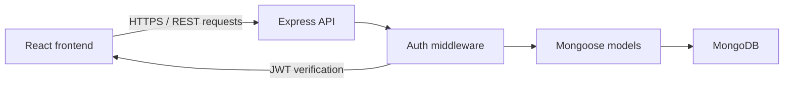

# FoodNest-Enhanced

FoodNest-Enhanced is a full-stack food inventory management application designed to help individuals and small households track food items, monitor expiry dates, and reduce waste through a simple dashboard and inventory workflow.

The application solves a common household and small-business problem: keeping track of food stock, knowing what is about to expire, and managing inventory without spreadsheets or manual logs. The intended users are home cooks, small food storage managers, and anyone who wants a lightweight way to track food items and expiry information.

## Project objective

The primary objective of FoodNest-Enhanced is to provide a simple, secure, and user-scoped food inventory system with login, protected access, expiry monitoring, and CSV export. The app is structured as a React frontend and an Express + MongoDB backend, with authentication enforced before inventory actions are allowed.

## Implemented features

The following features are confirmed in the current codebase:

- User registration and login
- JWT-based authentication using bearer tokens
- Protected frontend routes and protected backend endpoints
- User-specific food inventory tracking
- Add, view, edit, and delete food items
- Dashboard summary cards for total items, total quantity, expiring soon items, and expired items
- Expiry reminders for items expiring within the next 7 days and for already expired items
- Search and sorting for inventory items in the inventory page
- CSV export of inventory data
- Validation for registration, login, password changes, and inventory item inputs
- Basic backend error handling and user-specific access enforcement

## Planned or future improvements

The following items are not presented as complete or delivered features in this project:

- Full database-backed integration testing in CI or local CI environments
- Broader automated coverage for all frontend flows
- Advanced analytics, reporting, and charts
- More comprehensive form and business-rule validation
- Production deployment pipeline and monitoring

## Technology stack

### Frontend

- React 19
- Vite 8
- Bootstrap 5
- React Router DOM 7
- Axios
- ESLint and React refresh plugin

### Backend

- Node.js
- Express 5.2.1
- Mongoose 9.7.0
- CORS
- dotenv
- bcryptjs
- jsonwebtoken

### Database

- MongoDB via Mongoose models
- User and food documents are stored in MongoDB, with Mongoose schemas used for validation and data structure

### Authentication and security

- JWT-based authentication
- Bearer token verification via custom middleware
- Password hashing with bcryptjs
- CORS allowlist for local frontend origins
- Security headers and basic request validation
- Rate limiting for authentication endpoints

### Testing and development tools

- Jest 30.5.2
- Supertest 7.3.1
- MongoMemoryServer 11.3.0
- Vitest 5.0.4
- Testing Library React and Jest DOM
- jsdom
- Nodemon

## Screenshots

The following sections are placeholders for screenshots that can be added later. No screenshots are included in the repository at this time.

### Login page

Add a screenshot of the login screen here.

### Dashboard

Add a screenshot of the home/dashboard summary cards and expiry reminders here.

### Inventory management page

Add a screenshot of the inventory list, add/edit form, and search/sort controls here.

### Expiry reminders

Add a screenshot showing the expiring soon and expired items sections here.

### CSV export

Add a screenshot of the export flow or exported CSV file here if a suitable capture is created later.

## Architecture

The application follows a simple request flow:

React frontend → Express API → authentication middleware → Mongoose models → MongoDB

The frontend is built with Vite and React. The app uses `import.meta.env.VITE_API_URL` to build the base URL for the backend API, then calls Express routes such as `/api/login`, `/api/register`, and `/api/items` using Axios.

The Express server in `backend/server.js` defines the API routes, validates user input, and secures protected resources using the JWT middleware in `backend/middleware/auth.js`. The middleware reads the `Authorization` header, expects a `Bearer` token, verifies it against `JWT_SECRET`, and attaches the decoded user to `req.user`.

Inventory actions are scoped to the authenticated user. When creating, reading, updating, or deleting inventory items, the backend queries or updates records where `userId` matches the authenticated user ID. This prevents one user from modifying another user's food records.



## Project folder structure

```text
FoodNest-Enhanced/
├── README.md
├── package.json
├── .gitignore
├── FoodNest(Food Items Management App).txt
├── backend/
│   ├── .env
│   ├── audit.json
│   ├── jest.config.js
│   ├── package.json
│   ├── server.js
│   ├── middleware/
│   │   └── auth.js
│   ├── models/
│   │   ├── Food.js
│   │   └── User.js
│   ├── routes/
│   │   └── foodRoutes.js
│   ├── tests/
│   │   ├── api.mock.test.js
│   │   └── api.test.js
│   └── node_modules/   # local install artifacts, generated during setup
├── frontend/
│   ├── README.md
│   ├── package.json
│   ├── vite.config.js
│   ├── index.html
│   ├── eslint.config.js
│   ├── vercel.json
│   ├── public/
│   ├── src/
│   │   ├── App.jsx
│   │   ├── App.css
│   │   ├── index.css
│   │   ├── main.jsx
│   │   ├── components/
│   │   │   ├── Footer.jsx
│   │   │   ├── Header.jsx
│   │   │   ├── Layout.jsx
│   │   │   ├── ProtectedRoute.jsx
│   │   │   └── SideNav.jsx
│   │   ├── pages/
│   │   │   ├── About.jsx
│   │   │   ├── Contact.jsx
│   │   │   ├── Courses.jsx
│   │   │   ├── Dashboard.jsx
│   │   │   ├── Home.jsx
│   │   │   ├── LandingPage.jsx
│   │   │   ├── Login.jsx
│   │   │   ├── Profile.jsx
│   │   │   └── Register.jsx
│   │   ├── assets/
│   │   ├── test/
│   │   │   └── setup.js
│   │   └── App.test.jsx
│   └── node_modules/   # local install artifacts, generated during setup
├── docs/
│   ├── API.md
│   ├── TESTING.md
│   └── SECURITY.md
└── node_modules/       # generated install artifacts for the root workspace
```

### Important files and their purpose

- `backend/server.js`: Express server setup, CORS, security headers, validation, authentication routes, and inventory endpoints
- `backend/middleware/auth.js`: verification of JWT bearer tokens and user identity checks
- `backend/models/User.js`: user schema for registration and login
- `backend/models/Food.js`: food item schema and user ownership relationship
- `backend/routes/foodRoutes.js`: standalone Express router for food items; the main server currently defines the inventory routes directly instead of mounting this router
- `backend/tests/api.mock.test.js`: mocked route-level validation of authentication, registration, and inventory ownership logic
- `backend/tests/api.test.js`: MongoMemoryServer-based integration test file that requires an isolated MongoDB test database
- `backend/jest.config.js`: Jest test configuration
- `frontend/src/App.jsx`: application routing and protected route wrappers
- `frontend/src/components/ProtectedRoute.jsx`: frontend route guard that redirects unauthenticated users to the login page
- `frontend/src/pages/Login.jsx`: login form and token handling
- `frontend/src/pages/Register.jsx`: user registration flow
- `frontend/src/pages/Home.jsx`: dashboard summary and expiry reminder cards
- `frontend/src/pages/Courses.jsx`: inventory management, search, sorting, and CSV export
- `frontend/src/pages/Profile.jsx`: profile viewing and password update functionality
- `frontend/vite.config.js`: Vite and Vitest configuration with a jsdom test environment
- `.gitignore`: protects `.env`, local install folders, logs, and editor files

## Prerequisites

Before running the project, ensure the following tools are available:

- Node.js and npm
- MongoDB or a compatible MongoDB service for the backend
- Git, if you plan to clone or manage the repository

Version compatibility should follow the versions declared in the project package files. No additional framework-specific minimum versions were added beyond the package definitions used in this project.

## Installation and setup

### 1. Clone or open the project

If the repository remote is already known, clone it using the correct URL. If the remote is not confirmed, open the existing project folder directly in VS Code or clone the correct repository before making any changes.

```powershell
git clone <repository-url>
cd FoodNest-Enhanced
```

If the folder already exists locally, open it directly:

```powershell
cd C:\Users\Praveen\FoodNest-Enhanced
```

### 2. Install backend dependencies

```powershell
cd backend
npm install
```

### 3. Install frontend dependencies

```powershell
cd ..\frontend
npm install
```

### 4. Configure environment variables

Create a local `.env` file in the backend folder and keep it out of source control. The app expects the following environment variables.

Example backend configuration:

```env
MONGO_URI=mongodb://127.0.0.1:27017/foodnest
JWT_SECRET=replace_with_a_long_random_secret
PORT=3000
NODE_ENV=development
```

The frontend also expects a `VITE_API_URL` value, typically set in a frontend `.env` file:

```env
VITE_API_URL=http://localhost:3000
```

The exact values should be set to your local environment and must not be committed to Git.

### 5. Start the backend

Open a terminal in the project root or `backend` directory and run:

```powershell
cd backend
npm start
```

For development mode with automatic restarts:

```powershell
cd backend
npm run dev
```

### 6. Start the frontend in a separate terminal

```powershell
cd frontend
npm run dev
```

### 7. Open the application

After the frontend starts, open the local Vite URL in the browser, which is commonly:

```text
http://localhost:5173
```

The backend listens on the configured port, which is usually:

```text
http://localhost:3000
```

## Environment variables

The application uses the following variables that are referenced directly in the source code:

- `MONGO_URI`
  - Purpose: MongoDB connection string for the backend.
  - Example: `mongodb://127.0.0.1:27017/foodnest`
  - Security note: use a local or isolated MongoDB instance; do not share production connection strings in the repository.

- `JWT_SECRET`
  - Purpose: secret used to sign and verify JWT tokens for login and protected API access.
  - Example: `JWT_SECRET=replace_with_a_long_random_secret`
  - Security note: keep this value private, unique to the environment, and never committed to source control.

- `PORT`
  - Purpose: backend server port.
  - Example: `PORT=3000`

- `NODE_ENV`
  - Purpose: environment flag used to determine whether startup and test safeguards are active.
  - Example: `NODE_ENV=development`

- `VITE_API_URL`
  - Purpose: base URL used by the React app to reach the backend API.
  - Example: `VITE_API_URL=http://localhost:3000`
  - Security note: this value is client-visible and should point only to the intended local or deployed backend.

All environment files should be treated as local secrets and kept out of Git.

## API documentation

The following endpoints are confirmed in the source code and are the ones the project currently implements.

### GET /

- Method: `GET`
- Path: `/`
- Authentication: Not required
- Description: Returns a simple backend health message.
- Successful response:
  - Status: `200`
  - Body: `"Backend server is running"`

### POST /api/register

- Method: `POST`
- Path: `/api/register`
- Authentication: Not required
- Request body:

```json
{
  "fullname": "Alice Tester",
  "email": "alice@example.com",
  "password": "P@ssword123"
}
```

- Field validation:
  - `fullname` must be a non-empty string of at least 2 characters
  - `email` must match a valid email pattern
  - `password` must be at least 8 characters long
- Successful response:
  - Status: `200`
  - Body:

```json
{
  "message": "Registration Successful"
}
```

- Relevant error responses:
  - `400` when validation fails or when the email is already registered
  - `500` when registration fails unexpectedly

### POST /api/login

- Method: `POST`
- Path: `/api/login`
- Authentication: Not required
- Request body:

```json
{
  "email": "alice@example.com",
  "password": "P@ssword123"
}
```

- Successful response:
  - Status: `200`
  - Body:

```json
{
  "message": "Login Successful",
  "token": "jwt-token-example",
  "user": {
    "id": "user-id",
    "fullname": "Alice Tester",
    "email": "alice@example.com"
  }
}
```

- Relevant error responses:
  - `400` for invalid email, invalid password, or invalid login attempt
  - `500` if login fails unexpectedly

### PUT /api/change-password

- Method: `PUT`
- Path: `/api/change-password`
- Authentication: Required via JWT bearer token
- Request body:

```json
{
  "newPassword": "NewPassword123"
}
```

- Successful response:
  - Status: `200`
  - Body:

```json
{
  "message": "Password Changed Successfully"
}
```

- Relevant error responses:
  - `400` for short or invalid passwords
  - `401` for missing or invalid bearer token
  - `404` if the user does not exist
  - `500` on unexpected server error

### POST /api/items

- Method: `POST`
- Path: `/api/items`
- Authentication: Required via JWT bearer token
- Request body:

```json
{
  "name": "Apples",
  "category": "Fruit",
  "quantity": 5,
  "expiryDate": "2026-12-31T00:00:00.000Z",
  "status": "In Stock"
}
```

- Notes:
  - `userId` is set automatically from the authenticated user.
  - `quantity` must be a non-negative integer.
  - `name`, `category`, and `expiryDate` are validated before insertion.
- Successful response:
  - Status: `201`
  - Body:

```json
{
  "message": "Item Added Successfully",
  "item": {
    "_id": "item-id",
    "userId": "user-id",
    "name": "Apples",
    "category": "Fruit",
    "quantity": 5,
    "expiryDate": "2026-12-31T00:00:00.000Z",
    "status": "In Stock"
  }
}
```

- Relevant error responses:
  - `400` for invalid item input
  - `401` for missing or invalid token
  - `500` on save failure

### GET /api/items

- Method: `GET`
- Path: `/api/items`
- Authentication: Required via JWT bearer token
- Successful response:
  - Status: `200`
  - Body: array of item objects belonging to the authenticated user
- Relevant error responses:
  - `401` for missing or invalid bearer token
  - `500` for fetch failure

### PUT /api/items/:id

- Method: `PUT`
- Path: `/api/items/:id`
- Authentication: Required via JWT bearer token
- Request body example:

```json
{
  "quantity": 10,
  "status": "Low Stock"
}
```

- Notes:
  - The update is scoped to the authenticated user.
  - `quantity` must be a non-negative integer.
- Successful response:
  - Status: `200`
  - Body:

```json
{
  "message": "Item Updated Successfully",
  "updatedItem": {
    "_id": "item-id",
    "userId": "user-id",
    "quantity": 10,
    "status": "Low Stock"
  }
}
```

- Relevant error responses:
  - `400` for invalid quantity or invalid status
  - `401` for missing or invalid token
  - `404` if the item is not found or belongs to another user
  - `500` on update failure

### DELETE /api/items/:id

- Method: `DELETE`
- Path: `/api/items/:id`
- Authentication: Required via JWT bearer token
- Successful response:
  - Status: `200`
  - Body:

```json
{
  "message": "Item Deleted Successfully"
}
```

- Relevant error responses:
  - `401` for missing or invalid token
  - `404` if the item is not found or access is denied
  - `500` on deletion failure

### GET /api/profile

- Method: `GET`
- Path: `/api/profile`
- Authentication: Required via JWT bearer token
- Successful response:
  - Status: `200`
  - Body: user document without password field
- Relevant error responses:
  - `401` for missing or invalid token
  - `404` if the user does not exist
  - `500` on unexpected error

### PUT /api/update-profile

- Method: `PUT`
- Path: `/api/update-profile`
- Authentication: Required via JWT bearer token
- Request body:

```json
{
  "fullname": "Alice Updated"
}
```

- Successful response:
  - Status: `200`
  - Body:

```json
{
  "message": "Profile Updated Successfully",
  "user": {
    "_id": "user-id",
    "fullname": "Alice Updated"
  }
}
```

- Relevant error responses:
  - `400` if the full name is invalid
  - `401` for missing or invalid token
  - `404` if the user is not found
  - `500` on update failure

## Database and data models

### User model

The `User` model is defined in `backend/models/User.js` and contains the following fields:

- `fullname`: required string
- `email`: required string, unique index
- `password`: required string
- timestamps: created and updated dates are added automatically

This model is used for account creation, login, profile retrieval, and password updates.

### Food model

The `Food` model is defined in `backend/models/Food.js` and contains the following fields:

- `userId`: required `ObjectId` reference to `User`, with an index
- `name`: required string
- `category`: required string
- `quantity`: required number
- `expiryDate`: required date
- `status`: optional string with default value `"In Stock"`

### Ownership and access control

Inventory is associated with the authenticated user by storing the current logged-in user's ID in `userId` whenever a food item is created. Every item lookup, update, and delete operation is filtered by both the item ID and `userId`. This is confirmed in `backend/server.js`, where queries like `FoodItem.find({ userId: req.user.id })` and `findOneAndUpdate({ _id: req.params.id, userId: req.user.id }, ...)` are used.

This means each logged-in user can only read, update, or delete their own inventory records.

## Testing

### Confirmed test commands

Backend tests:

```powershell
cd backend
npm test
```

The project also contains a mocked route-focused suite that can be run directly:

```powershell
cd backend
npx jest tests/api.mock.test.js --runInBand
```

Frontend tests:

```powershell
cd frontend
npm test
```

### Test configuration and notes

- `backend/jest.config.js` configures Jest to run Node-based tests matching `**/tests/**/*.test.js`.
- `frontend/vite.config.js` configures Vitest with the `jsdom` environment and a shared setup file.
- `frontend/src/test/setup.js` loads `@testing-library/jest-dom/vitest`.

### Current verified status

The following test outcomes are confirmed in the current project state:

- The mocked backend suite in `backend/tests/api.mock.test.js` passed successfully in the earlier verification run: 6 tests passed.
- The frontend Vitest suite passed successfully: 6 tests passed.

### Important limitation

The database-backed backend test file `backend/tests/api.test.js` is designed to start MongoDB with `mongodb-memory-server` and is not a confirmed passing suite in this environment. The previous environment run showed that the MongoDB binary could not be started in this machine, so this test path remains unverified until an isolated local MongoDB binary or a compatible environment is available.

This means the mocked backend tests are useful for route-level validation, but they do not replace real database-backed integration tests.

## Security

The codebase includes the following security controls that are confirmed by inspection:

- Password hashing with `bcryptjs` before user records are stored.
- JWT-based session validation with `jsonwebtoken` and bearer token parsing.
- Protected inventory endpoints that require authentication and check `req.user.id` before performing item operations.
- CORS restrictions that only allow local development origins and reject disallowed origins.
- Security headers configured in `backend/server.js`: `X-Content-Type-Options`, `X-Frame-Options`, `Referrer-Policy`, and `Permissions-Policy`.
- Authentication rate limiting on `/api/login` and `/api/register` to reduce brute-force pressure.
- `.gitignore` entries that exclude `.env` files from Git.

### Security limitations

This project should not be described as fully production-secure. The code confirms basic authentication and validation safeguards, but it does not replace a full security review, production environment hardening, or a managed deployment setup. Frontend route protection is a convenience guard and does not replace backend authorization.

## Troubleshooting

### Backend startup errors

- Check that the MongoDB connection string is set in `backend/.env`.
- Verify `JWT_SECRET` is present when running outside test mode.
- Confirm the port is not already in use if the server fails to bind to the port.

### MongoDB connection failures

- Ensure MongoDB is installed and running locally or that the `MONGO_URI` points to a reachable service.
- Confirm the connection string is a local or isolated test URI when running the test suite.
- Do not fall back to a production database for local testing; use a disposable or isolated database.

### Missing environment variables

- Check that `MONGO_URI`, `JWT_SECRET`, and `PORT` are configured in the backend `.env` file.
- Check that `VITE_API_URL` is configured in the frontend `.env` file if the frontend cannot reach the API.

### Frontend API URL configuration

- The frontend reads `VITE_API_URL` to build API requests.
- If the backend is running on `http://localhost:3000`, ensure the value is set consistently.
- If this value is missing, the app will not be able to reach the backend API.

### Port conflicts

- If `localhost:3000` or `localhost:5173` is already in use, stop the conflicting process or update the relevant port configuration.
- The backend sets the port using `process.env.PORT || 3000`.

### Dependency installation errors

- Delete local install artifacts only if necessary and reinstall with `npm install`.
- Ensure the correct project folder is used for backend and frontend dependencies.
- Avoid mixing the root project dependencies with backend and frontend dependency sets.

### Test database or MongoDB Memory Server failures

- Confirm the environment has access to the required MongoDB binary or compatible runtime.
- The project intentionally avoids using a production MongoDB connection in tests.
- If MongoMemoryServer cannot start, treat the database-backed integration suite as unavailable rather than switching to a live database.

## Future improvements

The following improvements are realistic and useful next steps for this project, but they are not listed as completed features:

- Database-backed integration test coverage with a stable test database setup
- Expanded frontend and backend automated coverage for edge cases
- Better analytics and reporting for expiry trends and stock health
- More robust input sanitization and validation for all forms
- Production deployment and monitoring configuration

## Author and contribution information

### Author

Praveen

### Contribution notes

This project is a portfolio-oriented full-stack application for managing food inventory and expiry tracking. It was created as a local project in the current workspace and is intended for demonstration and learning use.

No public deployment URL, license claim, or external collaborator list is included here because those details were not confirmed in the actual project files.

## Related documents

- [docs/API.md](docs/API.md)
- [docs/TESTING.md](docs/TESTING.md)
- [docs/SECURITY.md](docs/SECURITY.md)
